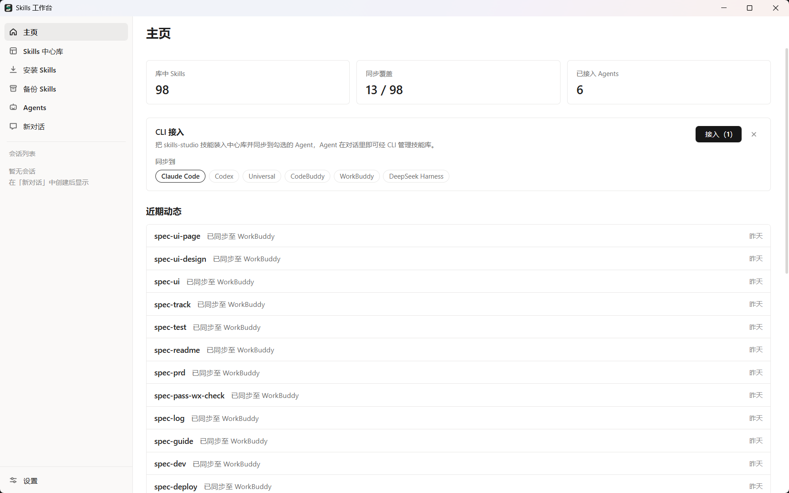
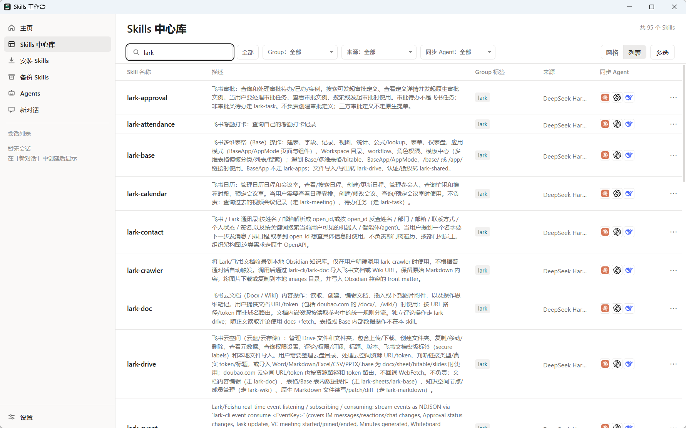
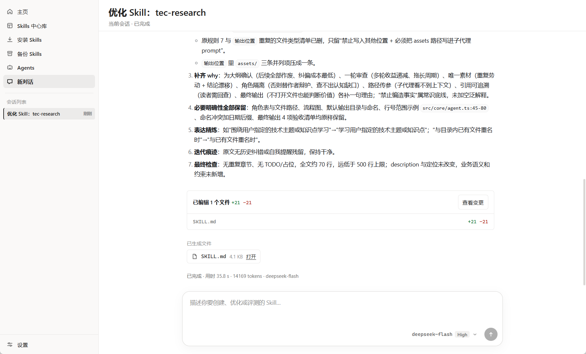

<div align="center">

# Skills Studio

**A Windows desktop workbench for AI agent skills (SKILL.md).**

Keep skills in one library, improve them with an AI agent, and deploy them to Claude Code, Codex, Cursor, and other coding tools.

[Download for Windows](https://github.com/xielm0/skills-studio/releases) · [Build from source](#build-from-source) · [简体中文](README.zh-CN.md)



</div>

## Why Skills Studio?

If you use more than one AI coding tool, your skills can end up in several global folders. It becomes difficult to tell which copy is current, where a skill came from, and which tools can use it.

Skills Studio brings those skills into a central library. You can inspect and edit a skill there, ask the built-in agent to review or improve it, then deploy it to selected tools through directory links. The library also keeps source information, tags, and Git backup history.

## Get started

1. Download the Windows x64 installer from [GitHub Releases](https://github.com/xielm0/skills-studio/releases) and install it. Windows 10 or 11 is required; the installer does not need administrator rights.
2. On first launch, scan your local agent skill folders and choose which skills to import. You can also install skills from [skills.sh](https://skills.sh), Git repositories, local folders, or zip archives.
3. Open **Skills 中心库** (Skills Library), choose a skill, and select the agents that should receive it. Importing a skill does not deploy it automatically.

To use AI review, improvement, or creation, add a model provider in **设置 → 模型配置** (Settings → Model Configuration). Library management and deployment work without a model provider. In the installed app, Git is needed for backup and multi-device sync.

## What you can do

- **Collect and find skills.** Search the central library by name or description, filter by source or Group tag, and inspect a skill's files before editing it.
- **Deploy to multiple agents.** Use managed links to make a library skill available in the global skill folders of Claude Code, Codex, Cursor, CodeBuddy, and other supported tools. Conflicting real directories are not silently deleted.
- **Improve skills in a conversation.** The built-in agent can review, improve, or create skills. Review reports stay in the library and are included in Git backups, rather than being deployed as skills.
- **Track sources and updates.** Browse the skills.sh marketplace and check supported sources for updates. Updates are presented for your decision; local changes are not silently replaced.
- **Back up and sync.** Keep local Git history or connect your own Git remote. Pull and Push are manual; when the same skill changes on two devices, choose which version to keep or keep both.
- **Let your coding agents use the library.** The app publishes a CLI on launch. The home page can connect its companion skill to the agents you select, so they can manage skills through the same library.





The app currently supports **Windows 10/11 x64** and has a **Chinese-language interface**. Batch review, skill publishing, and macOS/Linux support are planned.

## Build from source

You need Windows 10/11 x64, [Node.js 22.19 or newer](https://nodejs.org), and [Git](https://git-scm.com). Run these commands in Windows PowerShell from a fresh clone:

```powershell
git clone https://github.com/xielm0/skills-studio.git
cd skills-studio
npm ci --prefix agents
npm ci --prefix frontend
npm ci --prefix backend
```

Run the app directly from source:

```powershell
npm run start --prefix backend
```

Or build a Windows x64 installer suitable for a GitHub Release:

```powershell
npm run package:release --prefix backend
```

The installer is written to `backend/release/skills-studio-Setup-<version>-x64.exe`. The first package build downloads the Electron and installer toolchains. The committed `CURRENT_ENV` defaults to `production`, so these commands use your real user library. The release command checks this selection before packaging.

## Data and external services

The default library is `%USERPROFILE%\.skills-studio\skills-library`. Skills Studio does not require its own account or hosted backend. Model requests go to the provider you configure. Marketplace browsing, update checks, and syncing with a Git remote can also use network access. API keys are stored in Windows Credential Manager and are not included in library backups.

## Help and license

Questions, bug reports, and feature requests are welcome in [GitHub Issues](https://github.com/xielm0/skills-studio/issues). Pull requests are welcome too; include reproduction steps for bug reports.

Skills Studio is released under the [MIT License](LICENSE).
