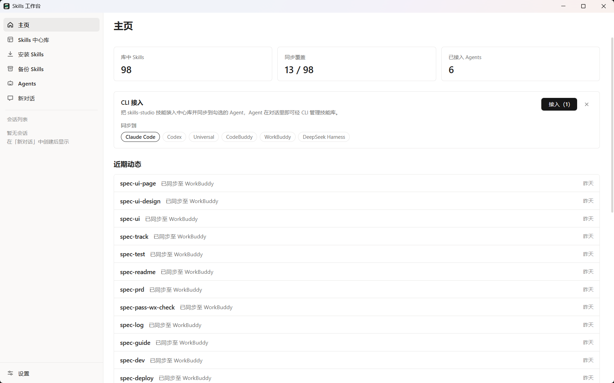
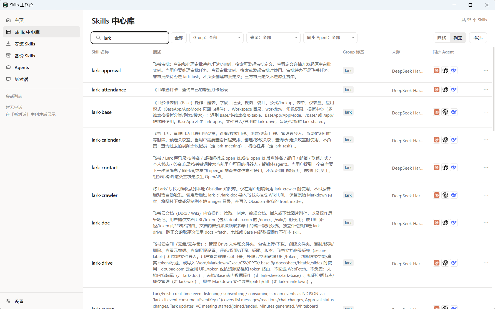
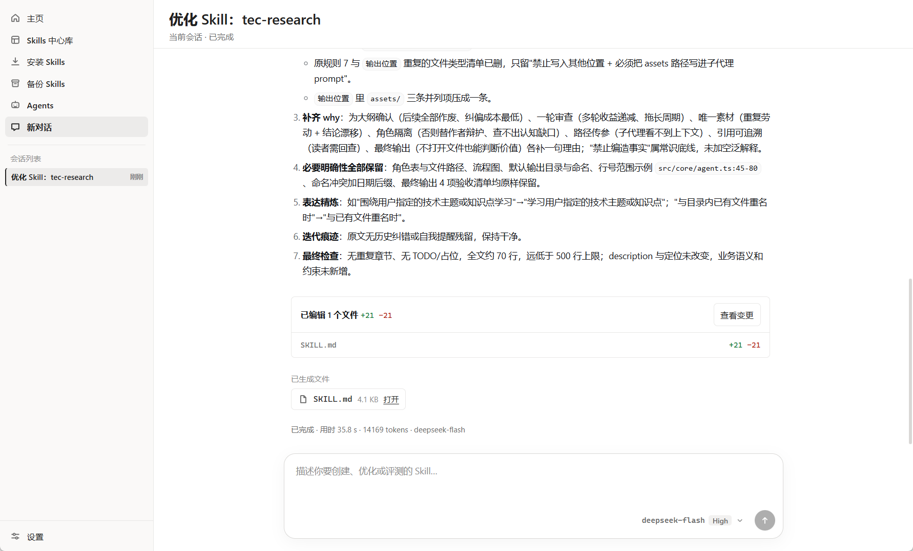

<div align="center">

# Skills 工作台

**面向 AI Agent Skills（SKILL.md）的 Windows 桌面工作台。**

把技能收进一个中心库，借助内置 Agent 改进技能，再部署给 Claude Code、Codex、Cursor 等编码工具使用。

[下载 Windows 安装包](https://github.com/xielm0/skills-studio/releases) · [从源码构建](#从源码构建) · [English](README.md)



</div>

## 为什么使用 Skills 工作台？

同时使用多个 AI 编码工具时，技能往往散落在各工具的全局目录里。你很难判断哪份内容是最新的、技能从哪来，以及哪些工具正在使用它。

Skills 工作台把这些技能收进中心库。你可以查看和编辑技能，让内置 Agent 在对话中评测或改进它，再通过目录链接部署到指定工具。中心库也会记录来源、标签和 Git 备份历史。

## 开始使用

1. 从 [GitHub Releases](https://github.com/xielm0/skills-studio/releases) 下载 Windows x64 安装包并安装。需要 Windows 10 或 11；安装不需要管理员权限。
2. 首次启动时，扫描本机 Agent 的技能目录，选择要导入的技能。你也可以从 [skills.sh](https://skills.sh)、Git 仓库、本地文件夹或 zip 压缩包安装技能。
3. 打开**Skills 中心库**，选择技能及要部署到的 Agent。导入技能不会自动部署。

如果要使用 AI 评测、改进或创建功能，请先在**设置 → 模型配置**中添加模型供应商。管理和部署技能不需要配置模型；安装版使用备份与多设备同步时需要 Git。

## 能做什么

- **集中收集与查找技能。** 在中心库按名称或描述搜索，按来源或 Group 标签筛选，并在编辑前查看技能文件。
- **部署给多个 Agent。** 通过受管理的链接，把中心库技能提供给 Claude Code、Codex、Cursor、CodeBuddy 等工具的全局技能目录；发生实体目录冲突时不会静默删除原目录。
- **在对话中改进技能。** 内置 Agent 可评测、改进或创建技能。评测报告留在中心库并随 Git 备份，不作为技能部署给 Agent。
- **追踪来源与更新。** 浏览 skills.sh 市场，检查受支持来源的更新；更新需由你决定是否应用，本地修改不会被静默覆盖。
- **备份与同步。** 保留本地 Git 历史，或连接自己的 Git 远端。Pull 和 Push 由你手动触发；两台设备修改了同一技能时，可选择保留哪份或两份都留。
- **让编码 Agent 使用中心库。** 应用启动时会发布 CLI。你可以在主页把配套技能接入选定的 Agent，让它们通过同一个中心库管理技能。





目前仅支持 **Windows 10/11 x64**，界面为**中文**。批量评测、技能发布和 macOS/Linux 支持仍在规划中。

## 从源码构建

需要 Windows 10/11 x64、[Node.js 22.19 或更新版本](https://nodejs.org)和 [Git](https://git-scm.com)。在 Windows PowerShell 中从全新克隆开始运行：

```powershell
git clone https://github.com/xielm0/skills-studio.git
cd skills-studio
npm ci --prefix agents
npm ci --prefix frontend
npm ci --prefix backend
```

直接从源码启动应用：

```powershell
npm run start --prefix backend
```

或者构建可用于 GitHub Release 的 Windows x64 安装包：

```powershell
npm run package:release --prefix backend
```

安装包输出到 `backend/release/skills-studio-Setup-<version>-x64.exe`。首次打包会下载 Electron 和安装工具链。仓库提交的 `CURRENT_ENV` 默认为 `production`，上述命令使用真实用户技能库；发版命令会在打包前检查该选择。

## 数据与外部服务

默认中心库位于 `%USERPROFILE%\.skills-studio\skills-library`。使用 Skills 工作台不需要注册它自己的账号或连接自建后端。模型请求会发往你配置的供应商；浏览技能市场、检查更新和同步 Git 远端也可能访问网络。API Key 保存在 Windows 凭据管理器中，不包含在技能库备份里。

## 反馈与许可

欢迎在 [GitHub Issues](https://github.com/xielm0/skills-studio/issues) 提问、报告 Bug 或提出功能建议，也欢迎提交 Pull Request。报告 Bug 时请附上复现步骤。

Skills 工作台基于 [MIT 许可证](LICENSE)发布。
